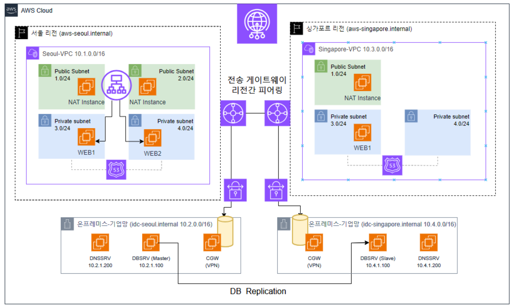

# aws-dr-infra

> **Multi-Region(서울·싱가포르)을 활용한 무중단 서비스 아키텍처**
> 서울 리전 장애 시 Global Accelerator가 트래픽을 싱가포르 리전으로 자동 전환하는 AWS DR(재해복구) 구성 프로젝트입니다. (개인 프로젝트)



## 1. 프로젝트 목적

- 각 리전에 VPC를 구성하고 **Transit Gateway**로 두 리전의 VPC와 IDC(온프레미스 가정) 네트워크를 연결
- IDC ↔ AWS 구간은 **Site-to-Site VPN**으로 암호화된 사설 통신 구성
- **Route 53 Resolver + 내부 DNS 서버**로 리전 간 도메인 이름 기반 통신 구현
- 서울 IDC의 **Master DB → 싱가포르 IDC의 Slave DB 복제**로 데이터 손실 방지
- **Global Accelerator** 헬스체크 기반으로 장애 시 다른 리전으로 자동 페일오버

### 시나리오
아시아 시장을 대상으로 하는 가상의 글로벌 패션·뷰티 이커머스 기업 "GlobalStyle"이 서울·싱가포르에 인프라를 구축하여, 한 리전에 장애가 나도 서비스가 중단되지 않도록 하는 상황을 가정했습니다.


## 2. 사용 서비스

| 서비스 | 용도 |
|---|---|
| VPC / EC2 | 리전별 네트워크, 웹 서버, NAT 인스턴스, DNS·DB·VPN 서버 |
| Application Load Balancer | 서울 프라이빗 웹 서버 부하 분산 |
| Transit Gateway (+ Peering) | VPC·VPN 연결, 리전 간 라우팅 |
| Site-to-Site VPN | AWS ↔ IDC 암호화 통신 (Openswan CGW) |
| Route 53 (Private Hosted Zone, Resolver) | 내부 도메인 해석, 리전 간 DNS 포워딩 |
| Global Accelerator | 헬스체크 기반 자동 페일오버 |
| CloudFormation | 리전별 인프라 코드화 |

## 3. 네트워크 구성

| 구분 | 대역 | 내부 도메인 | 주요 구성 |
|---|---|---|---|
| Seoul VPC | 10.1.0.0/16 | awsseoul.internal | Public 2 / Private 2, NAT 인스턴스 2, ALB, 웹 서버 2 |
| IDC Seoul | 10.2.0.0/16 | idcseoul.internal | DNS 10.2.1.200, **Master DB 10.2.1.100**, CGW(VPN) |
| Singapore VPC | 10.3.0.0/16 | awssingapore.internal | Public 1 / Private 2, NAT 인스턴스 1, 웹 서버 1 |
| IDC Singapore | 10.4.0.0/16 | idcsingapore.internal | DNS 10.4.1.200, **Slave DB 10.4.1.100**, CGW(VPN) |

- VPC ↔ TGW: VPC Attachment
- TGW ↔ IDC: Site-to-Site VPN (정적 라우팅)
- 서울 TGW ↔ 싱가포르 TGW: Peering Connection (정적 라우팅으로 10.1~10.4 대역 확보)

## 4. 검증 결과

| 항목 | 방법 | 결과 |
|---|---|---|
| 리전 간 통신 | 서울↔싱가포르 양방향 `pingall.sh` | 웹/DB/DNS 서버 IP·도메인 모두 up |
| DNS 해석 | 양방향 `dig +short` | 4개 도메인의 서버 이름 정상 해석 |
| DB 복제 | `SHOW SLAVE STATUS\G` | `Slave_IO_Running: Yes`, `Slave_SQL_Running: Yes`, `Last_Errno: 0` |
| 평상시 | Global Accelerator 접속 | 서울 웹 서버(WEBSRV1/2)로 응답, 회원 등록·조회 정상 |
| **장애 전환** | 서울 Master DB 중지 | 아래 참고 |

### 장애 전환 시나리오
1. 서울 IDC Master DB 인스턴스 중지
2. 웹 서버가 DB에 연결하지 못해 ALB 타겟 그룹 EC2가 **Unhealthy**
3. Global Accelerator가 서울 엔드포인트 이상을 감지
4. 트래픽이 자동으로 **싱가포르 엔드포인트**로 전환되어 Singapore Admin Page 응답

## 5. 저장소 구성

```
aws-dr-infra/
├── README.md
├── docs/
│   └── architecture.png
└── cloudformation/
    ├── seoul-region.yaml        # 서울 VPC, IDC, ALB, 웹, TGW, VPN, DNS (77 리소스)
    └── singapore-region.yaml    # 싱가포르 VPC, IDC, 웹, TGW, VPN, DNS (63 리소스)
```

### 코드화 범위
| 코드(CloudFormation)에 포함 | 콘솔/수동으로 구성 |
|---|---|
| VPC, 서브넷, NAT 인스턴스, ALB, 웹/DNS/DB/CGW 서버, TGW와 VPC Attachment, VPN, Route 53 | TGW 리전 간 Peering, TGW 정적 경로, MySQL Master–Slave 복제 설정, Global Accelerator |

## 6. 배포 방법 (요약)
1. 서울·싱가포르 스택을 각각 배포 (비밀번호·PSK는 `CHANGE_ME_*` 값을 본인 값으로 교체)
2. 각 리전 VPN 연결 후 CGW(Openswan) 설정
3. TGW Peering 생성 및 수락, 양쪽 TGW 라우팅 테이블에 정적 경로 추가
4. DB Master/Slave 복제 설정
5. Global Accelerator에 서울 ALB, 싱가포르 엔드포인트 등록

## 7. 트러블슈팅
| 문제 | 원인 / 해결 |
|---|---|
| 내부 도메인 해석 실패 | resolv.conf의 DNS 설정 확인 후 수정 |
| VPN 터널 미연결 | VPN 서비스 재시작 |
| 장애 전환 테스트에서 싱가포르 웹이 서울 DB(10.2.1.100)를 바라봄 | 싱가포르 웹 서버 설정을 10.4.1.100으로 수정 |
| MySQL 사용자 생성·권한 오류 | 비밀번호 정책(validate_password), 임시 비밀번호, 권한 부여 순서 확인 |
| 웹 서버 PHP-DB 연동 실패 | php-mysql 패키지 설치 |
| AMI 문제로 약 2일 소요 | (원인/해결 내용을 직접 보완) |

ㄴ
